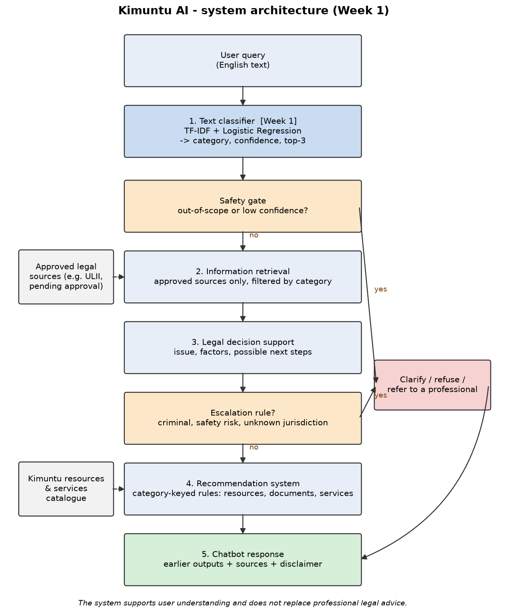

# System Architecture

The Mermaid source is in [`architecture.mmd`](architecture.mmd). The PNG is drawn by
[`src/draw_architecture.py`](../src/draw_architecture.py) and shows the same flow.

> **Disclaimer:** the system supports user understanding and does not replace professional legal advice.

## Flow

The design follows the lecturer note's recommended flow:
**User Query → Text Classification → Information Retrieval → Decision Support → Recommendation → Chatbot Response**.

| Step | Component | Input | Output | Built in |
|---|---|---|---|---|
| 1 | **Text classifier** | User's query text | `{category, confidence, top_3, needs_clarification}` | **Week 1 (this work)** |
| – | **Safety gate** | Classifier output | Continue, or route to clarify/refer | Week 1 logic (threshold); used by chatbot later |
| 2 | **Information retrieval** | Query + category | Passages from *approved* sources, with references | Later weeks |
| 3 | **Legal decision support** | Query + category + retrieved passages | Issue, relevant factors, possible next steps; escalation flag | Later weeks |
| 4 | **Recommendation system** | Category + decision-support output | Kimuntu resources, documents, services or next actions, with a reason | Later weeks |
| 5 | **Chatbot** | Outputs of steps 1–4 | Clear conversational answer with sources and disclaimer | Later weeks |

## Why it is designed this way

- **Classification first.** Every later step depends on knowing the legal area. The category
  narrows retrieval to the right material and selects the right recommendation rules.
- **One shared interface.** All components use the classifier's output dictionary. This avoids
  the "four disconnected applications" risk named in the lecturer note.
- **Safety and uncertainty sit in two places:**
  1. *Safety gate after classification:* if the query is predicted `other_out_of_scope`, or the
     confidence is below a threshold chosen on validation data, the system does not continue. It
     asks the user to clarify, explains its scope, or refers them to a professional.
  2. *Escalation rules in decision support:* some situations always go to a professional, for
     example criminal matters, a risk to someone's safety, or a jurisdiction the system does not
     cover.
- **Grounded answers only.** Retrieval uses only approved sources. The Uganda Legal Information
  Institute (ULII, <https://ulii.org/>), run by the Law Reporting Unit of the Uganda Judiciary, is a
  *candidate* source for Ugandan legislation and judgments, pending Kimuntu's approval. The chatbot
  presents what the earlier components produced, with references, rather than generating free-form
  legal statements.
- **Simple, explainable technology.** The Week 1 classifier is a scikit-learn pipeline saved with
  joblib. Recommendation starts with rules keyed on category (explainable and testable). A FastAPI or
  Flask layer is added only when the chatbot needs to call the classifier as a service.

## Example walk-through

User: *"My landlord has refused to return my security deposit."*

1. Classifier → `housing_tenancy` with a confidence score.
2. Safety gate → confidence above threshold, in scope → continue.
3. Retrieval → approved tenancy material for the user's jurisdiction.
4. Decision support → issue: deposit not returned; factors: tenancy agreement, condition of the
   property, notice given; next steps: gather evidence, write to the landlord.
5. Recommendation → template demand letter, mediation or legal-aid contact.
6. Chatbot → explains the above in plain language, cites sources and adds the disclaimer.
