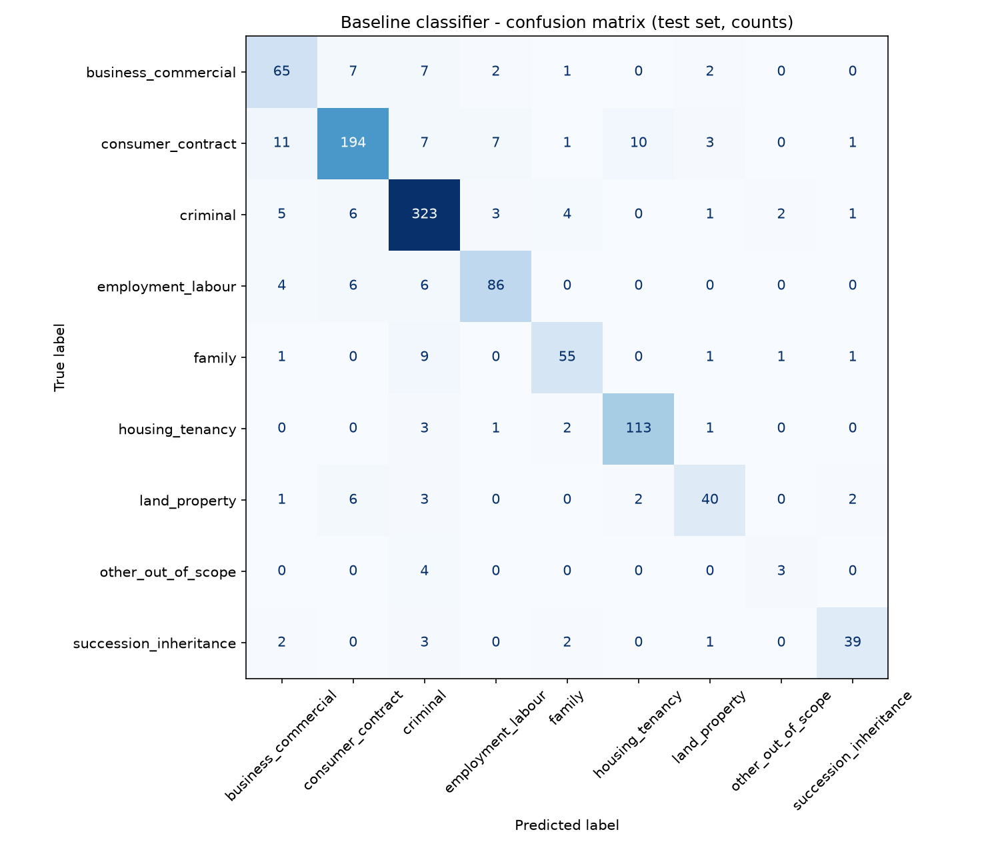

# Interpretation of Results, Limitations and Week 2 Plan

> **Disclaimer:** the classifier supports user understanding and does not replace professional legal advice.

All numbers below come from `src/train_baseline.py` (identical results from
`notebooks/baseline_classifier.ipynb`), saved in `results/`.

## 1. What was compared (validation set, 1,061 queries)

| Model (best setting of each) | Validation accuracy | Validation macro-F1 |
|---|---|---|
| Dummy: always predicts the most frequent class | 0.3242 | 0.0544 |
| Multinomial Naive Bayes (unigrams, English stop words removed, alpha = 0.01) | 0.7917 | 0.6685 |
| **Logistic Regression (unigrams, no stop-word removal, C = 5, balanced class weights)** | **0.8709** | **0.8574** |

Logistic Regression was selected because it had the highest validation macro-F1. Two further observations:
- **Bigrams did not help.** The best unigram+bigram Logistic Regression reached 0.8200 macro-F1.
- **Naive Bayes was much weaker on the small classes**, which macro-F1 makes visible. Its accuracy
  gap (0.79 vs 0.87) is smaller than its macro-F1 gap (0.67 vs 0.86).

The full table is in `results/validation_comparison.csv`.

## 2. Test results (run once, 1,061 queries)

| Subset | n | Accuracy | Macro precision | Macro recall | Macro F1 | Weighted F1 |
|---|---|---|---|---|---|---|
| All test | 1061 | 0.8652 | 0.8136 | 0.7924 | **0.8020** | 0.8644 |
| Law Stack Exchange only | 992 | 0.8669 | 0.7543 | 0.7344 | 0.7432 | 0.8669 |
| Synthetic only | 69 | 0.8406 | 0.8503 | 0.8393 | 0.8362 | 0.8385 |

Per category (test):

| Category | Precision | Recall | F1 | Support |
|---|---|---|---|---|
| business_commercial | 0.7303 | 0.7738 | 0.7514 | 84 |
| consumer_contract | 0.8858 | 0.8291 | 0.8565 | 234 |
| criminal | 0.8849 | 0.9362 | 0.9099 | 345 |
| employment_labour | 0.8687 | 0.8431 | 0.8557 | 102 |
| family | 0.8462 | 0.8088 | 0.8271 | 68 |
| housing_tenancy | 0.9040 | 0.9417 | 0.9224 | 120 |
| land_property | 0.8163 | 0.7407 | 0.7767 | 54 |
| other_out_of_scope | 0.5000 | 0.4286 | 0.4615 | 7 |
| succession_inheritance | 0.8864 | 0.8298 | 0.8571 | 47 |

## 3. What the results show

1. **The baseline clearly learns the legal areas.** Macro-F1 is 0.80 on unseen test queries, against
   0.05 for the dummy baseline on validation. The top words per class are sensible legal vocabulary,
   e.g. *landlord, lease, tenant, rent* for housing and *will, estate, trust, inherit, probate* for
   succession (`results/top_terms_per_class.txt`). The model is therefore explainable.
2. **Accuracy alone would be misleading.** Accuracy (0.8652) is higher than macro-F1 (0.8020), because
   the large classes (`criminal`, 345 test queries) are easier and dominate accuracy. Macro-F1 shows that
   the small classes are weaker.
3. **The weakest class is the most safety-relevant one.** `other_out_of_scope` has recall 0.4286
   (3 of 7 test queries). The other 4 were predicted `criminal`. Its top words are question-style words
   (*what, how, help*), so the model learned the *style* of the synthetic out-of-scope queries rather
   than the idea of "not a legal question".
4. **The safety gate partly compensates.** The confidence threshold of 0.35 was chosen on validation as
   the lowest value giving at least 90% accuracy on accepted queries. On the test set:
   - 91.42% of queries are answered directly (coverage), with 90.52% accuracy;
   - 51 of the 143 errors are caught by the threshold and would trigger a clarifying question;
   - all 4 misclassified out-of-scope test queries had confidence between 0.24 and 0.33, so all 4 were flagged.

   This still leaves 92 errors that pass with confidence ≥ 0.35.
5. **Most confusions are between legally neighbouring areas:**
   - consumer_contract → business_commercial (11) and → housing_tenancy (10);
   - family → criminal (9).

   These are areas that genuinely overlap: contracts appear in business and tenancy, and family
   situations can involve abuse or crime. Some "errors" are label noise from user-assigned tags. For
   example, a question asking for help with an LSAT exam answer is tagged `criminal-law`.
6. **Synthetic queries are not easier.** On synthetic test queries, accuracy was 0.8406, slightly *lower*
   than on Law Stack Exchange (0.8669). The Law Stack Exchange macro scores (0.7432) are lower than its
   accuracy partly because 2 Law Stack Exchange questions were predicted `other_out_of_scope`, a class
   with no Law Stack Exchange examples, which counts as a zero-scoring class in that subset's macro average.
   The synthetic test subset is only 69 queries, so its scores are uncertain.

## 4. Limitations of the baseline

| Limitation | Evidence from this work |
|---|---|
| **Out-of-scope detection is weak** and relies on 50 synthetic examples | Recall 0.4286 on 7 test queries; top words are generic question words |
| **No understanding of word meaning or context** (bag of words) | "Who will win the election next year?" was predicted `succession_inheritance` at confidence 0.4826 and *not* flagged, because "will" is the strongest succession word |
| **Data is mostly not Ugandan.** Law Stack Exchange is international and dominated by US/UK questions | 6,621 of 7,071 rows are Law Stack Exchange; Ugandan context comes only from the 450 synthetic rows |
| **Style mismatch between sources** | Law Stack Exchange texts average 148.5 words, synthetic queries 11.7 words; real chatbot queries will be short like the synthetic ones |
| **Synthetic bias.** One AI author, clean English, no code-switching (e.g. Luganda/English mixing) | All 450 synthetic queries written in one pass by one author |
| **Class imbalance** | `criminal` 2,297 rows vs `other_out_of_scope` 50 rows |
| **Noisy labels.** Tags are assigned by users, not experts | e.g. LSAT exam question tagged `criminal-law` |
| **Single label only** | A query can involve two areas (e.g. inheritance of land); only one is predicted |
| **No jurisdiction awareness** | The model does not detect the user's country, which decision support will need |
| **Demo queries partly overlap the training data** | Two queries used in early manual checks matched synthetic training sentences; the notebook demo therefore uses newly written queries |

## 5. Proposed Week 2 improvements

1. **Obtain Kimuntu's data and priorities.** Replace or supplement synthetic data with approved real
   queries; confirm jurisdictions and the priority categories.
2. **Strengthen out-of-scope detection.** Add real non-legal questions (e.g. from a licensed public
   general-question dataset) and legal questions outside our 8 areas (e.g. copyright, immigration) to
   `other_out_of_scope`; evaluate it with a larger test set.
3. **Reduce the style gap.** Train and test on Law Stack Exchange titles only, or on the first sentence,
   which are closer to chatbot-length queries, and compare.
4. **Error analysis with the team:** review `results/misclassified_test_examples.csv`, fix clear label
   noise, and refine the tag mapping and labelling rules.
5. **Better calibrated confidence:** use probability calibration and evaluate the threshold with the
   chatbot team, so that clarifying questions are asked at the right rate.
6. **Try one stronger but still explainable model,** e.g. a linear SVM or sentence embeddings with
   Logistic Regression. Keep it only if validation macro-F1 clearly improves.
7. **Expose `predict()` through a small FastAPI endpoint** once the chatbot component needs to call it,
   using the output format already defined in `src/predict.py`.
8. **Add a jurisdiction question** to the chatbot flow (the classifier cannot infer it), feeding the
   decision support escalation rules.
